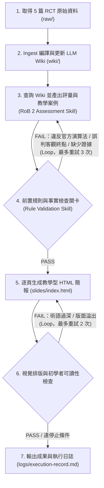

# RoB 2 偏差風險評量與規則驗證 — LLM Wiki 與教學 HTML 簡報

## 1. LLM Wiki 主題與簡短介紹

本專案建立了一個以 **Cochrane RoB 2（Risk of Bias 2）隨機對照試驗偏差風險評量** 為主題的 **LLM Wiki**，並結合兩個專職 AI Skill：
- **`RoB 2 Assessment Skill`**（`skills/rob2-assessment/SKILL.md`）：讀取 Wiki 知識庫與試驗文獻，依 5 大 Domain 與引導問題（Signaling Questions）執行結構化評量與教學案例拆解。
- **`Rule Validation Skill`**（`skills/rule-validation/SKILL.md`）：扮演前置檢查關卡（Validator），以 RoB 2 官方判定演算法與證據一致性規則稽核評量結果，杜絕 AI「憑感覺給分」或過度簡化。

本 Wiki 共 Ingest **5 篇真實臨床隨機對照試驗（RCT）**（4 篇心衰竭超濾開放標籤試驗 + 1 篇氣喘大型雙盲三期試驗 CAPTAIN），透過鮮明對照，讓原本不熟悉實證醫學與 RoB 2 的初學者，能藉由互動式 HTML 簡報快速掌握偏差風險評量邏輯。

---

## 2. 專案成果導覽

- **規則與架構定義**：[AGENTS.md](AGENTS.md)
- **LLM Wiki 總索引（可用 Obsidian 開啟本資料夾）**：[wiki/index.md](wiki/index.md)
- **Wiki 變更與 Lint 紀錄**：[wiki/log.md](wiki/log.md)
- **原始 5 篇文獻資料（唯讀層）**：`raw/`
- **雙 Skill 設計**：
  - [RoB 2 Assessment Skill](skills/rob2-assessment/SKILL.md)
  - [Rule Validation Skill](skills/rule-validation/SKILL.md)
- **教學型互動 HTML 簡報**：[slides/index.html](slides/index.html)（開啟 GitHub Pages 後即可直接線上瀏覽）
- **一次實際執行、抓錯修正紀錄與反思**：[logs/execution-record.md](logs/execution-record.md)

---

## 3. Loop / Graph 流程設計

### 為什麼這樣設計？
1. **哪些步驟重複執行？**
   - `節點 3 ↔ 節點 4`（內容與規則驗證 Loop，上限 3 次）：確保 RoB 2 評量與公式規則 100% 正確。
   - `節點 5 ↔ 節點 6`（簡報可讀性 Loop，上限 2 次）：確保無醫學背景讀者能看懂。
2. **哪些地方需要檢查或重新生成？**
   - 第一關用 `Rule Validation Skill` 驗證「硬規則」（Overall Risk 最高風險原則、D4 客觀終點不可因未盲化就自動判 High、證據需對應 `wiki/`）。
   - 第二關檢查簡報互動功能、白話解釋與視覺階層。
3. **為什麼把檢查拆成兩關？**
   - 將「生成者」與「審查者」分離，避免單一 Prompt 既當球員又當裁判；且透過明確重試上限（Stopping Condition）防止無窮迴圈。

---

## 4. 實際執行與反思摘要（詳見 `logs/execution-record.md`）

- **哪一個節點最常出錯？**
  - **節點 3（RoB 2 Assessment Skill）** 最常出現兩類錯誤：(1) 看到「Open-label（開放標籤）」就反射性將 **D4（結果測量偏差）** 一律判為 `High risk`，忽略了 RAPID-CHF 的「24 小時體重變化」屬於客觀測量指標；(2) 在總結 Overall Risk 時，未嚴格套用官方「任一 Domain 為 High 則 Overall 必為 High」的強制規則。
- **把檢查往前移到了哪一個步驟？**
  - 最初版本是在 HTML 簡報全部寫完後才人工檢查內容，一旦發現某篇試驗的 Domain 判定錯誤，就必須同步修改簡報卡片、統計圖與案例解說。因此我將 `Rule Validation Skill` **往前移至節點 4（大綱與評量結構化資料完成後、HTML 生成之前）**。
- **如何修改 Workflow / Graph？**
  - 將原本「線性生成 → 最後總檢查」改為「**前置規則驗證迴圈（節點 3↔4）＋ 後置視覺教學迴圈（節點 5↔6）**」的兩段式 Graph，讓邏輯錯誤在進入 HTML 排版前即被攔截修正。
