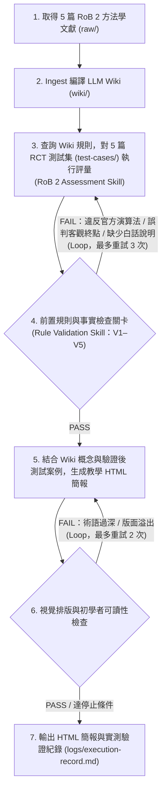

# RoB 2 偏差風險評量與規則驗證 — LLM Wiki 與教學 HTML 簡報

## 1. LLM Wiki 主題與資料分層設計

本專案建立了一個以 **Cochrane RoB 2（Risk of Bias 2）隨機對照試驗偏差風險評量方法學** 為主題的 **LLM Wiki**，並嚴格區分「**知識庫來源**」與「**外部測試集**」：

- **LLM Wiki 知識來源（`raw/` → `wiki/`，共 Ingest 5 篇方法學文獻）**：
  1. Sterne et al. (*BMJ* 2019) — RoB 2 原論文
  2. Cochrane RoB 2 Full Guidance — 官方完整操作指南
  3. RoB 2 Crib Sheet — 22 題 Signaling Questions 速查表
  4. RoB 2 Decision Algorithms — 官方確定性判定演算法
  5. Cochrane Handbook Chapter 8 — 偏差風險理論與開放標籤／客觀指標實務原則
- **外部實測資料集（`test-cases/`，共 5 篇真實 RCT 論文）**：
  - CUORE (2014)、Hanna et al. (2012)、Hu et al. (2020)、RAPID-CHF (2005)、CAPTAIN (2021)
  - 用來對雙 Skill（`RoB 2 Assessment Skill` ＋ `Rule Validation Skill`）進行實戰測試，測試與驗證結果完整記錄於 `logs/execution-record.md`，並作為教學簡報中的案例演示。

---

## 2. 專案成果導覽

- **規則與架構定義**：[AGENTS.md](AGENTS.md)
- **LLM Wiki 總索引（Obsidian 相容）**：[wiki/index.md](wiki/index.md)
- **Wiki 編譯與 Lint 紀錄**：[wiki/log.md](wiki/log.md)
- **方法學原始資料（5 篇）**：`raw/`
- **外部 RCT 測試集（5 篇）**：`test-cases/`
- **雙 Skill 設計**：
  - [RoB 2 Assessment Skill](skills/rob2-assessment/SKILL.md)
  - [Rule Validation Skill](skills/rule-validation/SKILL.md)
- **5 篇 RCT 測試驗證結果與反思**：[logs/execution-record.md](logs/execution-record.md)
- **教學型互動 HTML 簡報**：[slides/index.html](slides/index.html)（GitHub Pages：`https://fjuhpc00625.github.io/rob2-llm-wiki/slides/`）

---

## 3. Loop / Graph 流程設計

### 為什麼這樣設計？
1. **哪些步驟重複執行？**
   - `節點 3 ↔ 節點 4`（評量與規則驗證 Loop，上限 3 次）：確保 5 篇 RCT 測試結果完全符合 `wiki/` 中的 RoB 2 官方演算法。
   - `節點 5 ↔ 節點 6`（簡報可讀性 Loop，上限 2 次）：確保無醫學背景讀者能看懂。
2. **哪些地方需要檢查或重新生成？**
   - 第一關由 `Rule Validation Skill` 驗證硬規則（Overall Risk 一票否決 V1、D4 客觀終點防護 V2、D1 分配隱藏 V3、證據追溯 V4、白話術語 V5）。
   - 第二關檢查簡報互動體驗、版面與教學清晰度。
3. **為什麼把知識庫與測試集分離？**
   - 避免把「待評估的試驗案例」與「評估標準本身」混為一談：`wiki/` 永遠保持純淨的方法學規範，`test-cases/` 則可隨時抽換新論文來驗證雙 Skill 的泛化能力。

---

## 4. 實際執行與反思摘要（詳見 `logs/execution-record.md`）

- **哪一個節點最常出錯？**
  - **節點 3（RoB 2 Assessment Skill）** 在評估 `test-cases/` 時最常出現兩類錯誤：(1) 看到「Open-label」就反射性把 `RAPID-CHF` 的 **D4（24 小時體重變化）** 判為 `High`，違反規則 V2；(2) 在 `Hu et al. (2020)` 中 `D1 = High` 卻將 Overall Risk 判為 `Some concerns`，違反規則 V1。
- **把檢查往前移到了哪一個步驟？**
  - 將 `Rule Validation Skill` 從「HTML 簡報完成後的總檢查」**往前移至節點 4（測試評量完成後、HTML 簡報生成之前）**，在邏輯錯誤進入排版前即攔截修正。
- **如何修改 Workflow / Graph？**
  - 重構為「**前置規則驗證迴圈（節點 3↔4）＋ 後置視覺教學迴圈（節點 5↔6）**」兩段式 Graph，並明確切分 `raw/`（方法學知識來源）與 `test-cases/`（受測 RCT 案例），大幅減少返工並提升架構嚴謹度。
